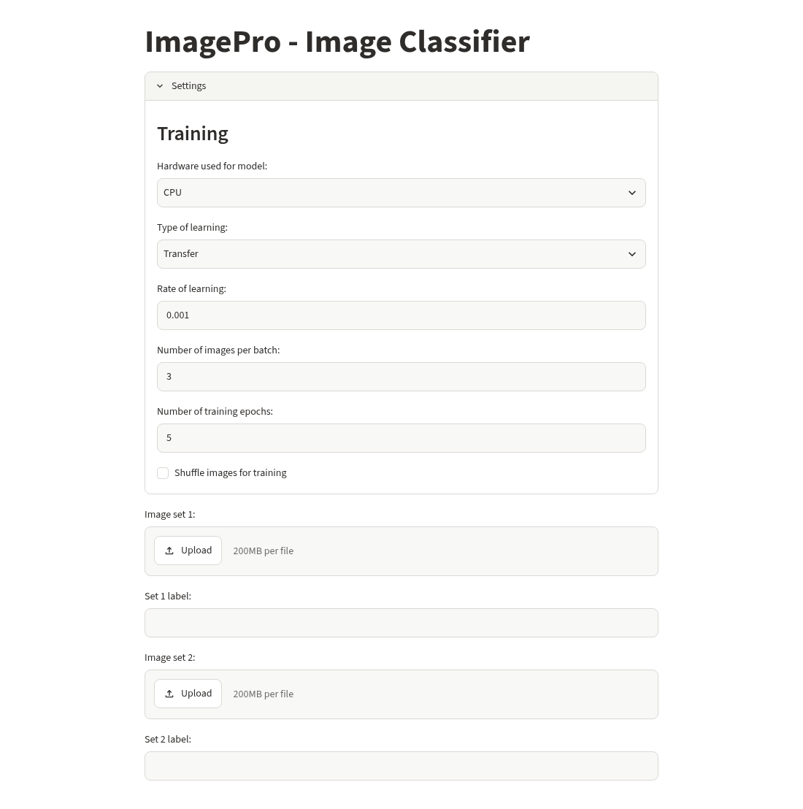

# ImagePro Classifier Teaching Tool

ImagePro is a Streamlit app for teaching two-class image classification. You upload two labeled sets of images, train the classification head of a ResNet-18 — either starting from ImageNet-pretrained weights or from a random initialization — and then classify a new test image. The app makes the basic supervised-learning loop tangible: labeled examples, a few training choices, a loss curve, and a prediction with a confidence score.



## What it teaches

The app walks through a complete two-class workflow in the browser.

**Settings.** Open the Settings expander to choose:

- Hardware: CPU, or GPU when Apple MPS or CUDA is available
- Type of learning: Transfer (ImageNet-pretrained ResNet-18) or Novel (randomly initialized ResNet-18)
- Rate of learning (default `0.001`)
- Number of images per batch (default `3`)
- Number of training epochs (default `5`)
- Whether to shuffle the training images (off by default)

In both Transfer and Novel mode, the ResNet-18 convolutional backbone is frozen. Only the final fully connected layer, which has two outputs, is trained, using Adam and cross-entropy loss.

**Labeled examples.** Upload an image set for each class and give each set a text label. Every image is converted to RGB, resized to 224×224, and normalized with the ImageNet mean and standard deviation. You can browse the uploaded images before training.

**Train and inspect.** Once both sets and labels are present, train the model. The app plots the total training loss after each epoch. Upload a single test image to see the predicted label and the model's softmax confidence.

The first time you train in Transfer mode, torchvision downloads the ResNet-18 ImageNet checkpoint, which requires a network connection.

## Install

Python 3.12, with the pinned versions in `requirements.txt`, is the setup that was verified to launch the app. From the repository root:

```bash
git clone https://github.com/jmamodeo/classifier-teaching-tool.git
cd classifier-teaching-tool
python3.12 -m venv venv
source venv/bin/activate
pip install -r requirements.txt
```

## Run

```bash
streamlit run main.py
```

The app opens in the browser. There is no command-line training path; all interaction happens in the Streamlit UI.

## Project layout

```
.
├── main.py              Streamlit app: uploads, training controls, loss plot, and prediction
├── models.py            ResNet-18 classification-head trainer and predictor
├── requirements.txt     Pinned runtime dependencies
├── docs/app.png         Screenshot of the app
├── CITATION.cff         Citation metadata for GitHub's "Cite this repository" button
├── LICENSE              MIT license
└── .github/workflows/ci.yml   Install and import smoke test on Python 3.12
```

## Citation

If you use this software, please cite it. GitHub's "Cite this repository" button uses [`CITATION.cff`](CITATION.cff).

## License

MIT. See [LICENSE](LICENSE).
