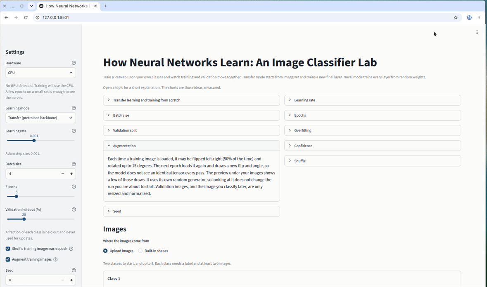
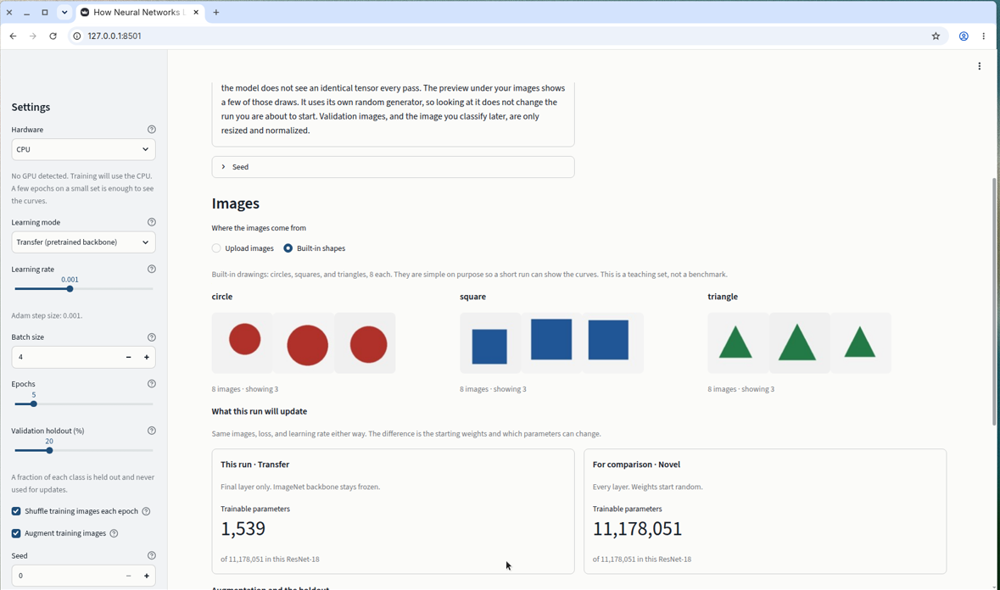
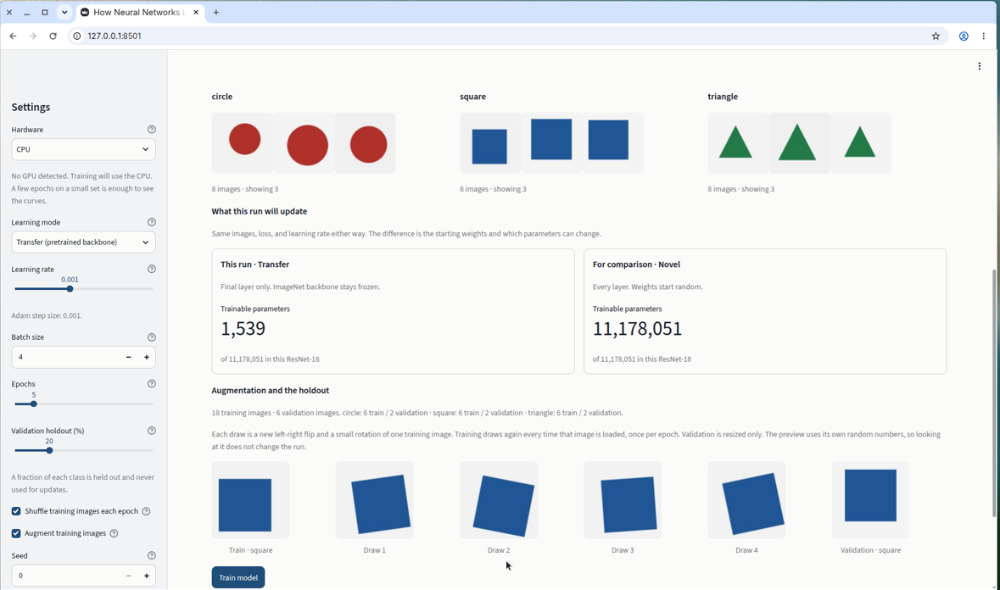
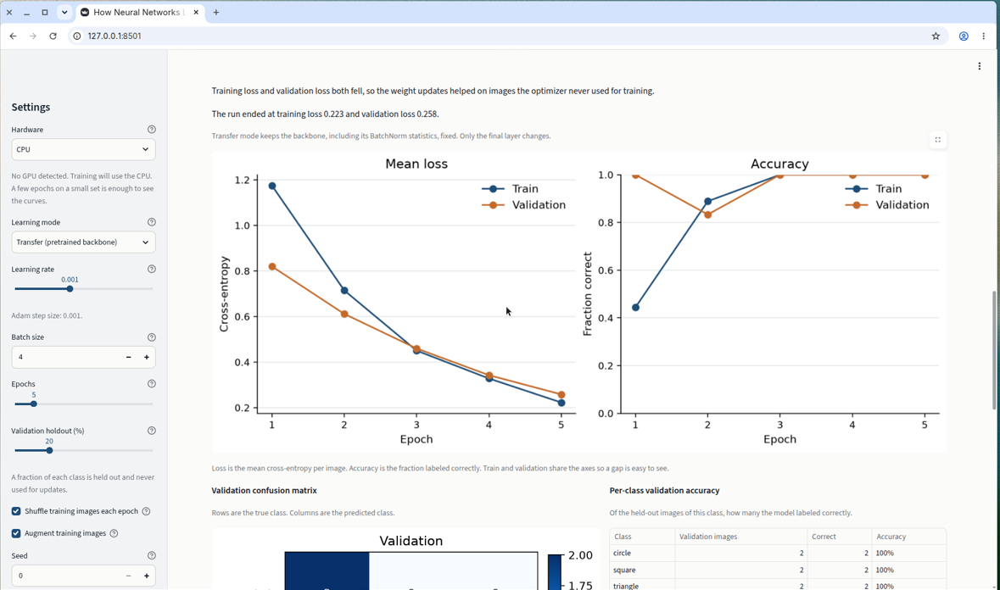
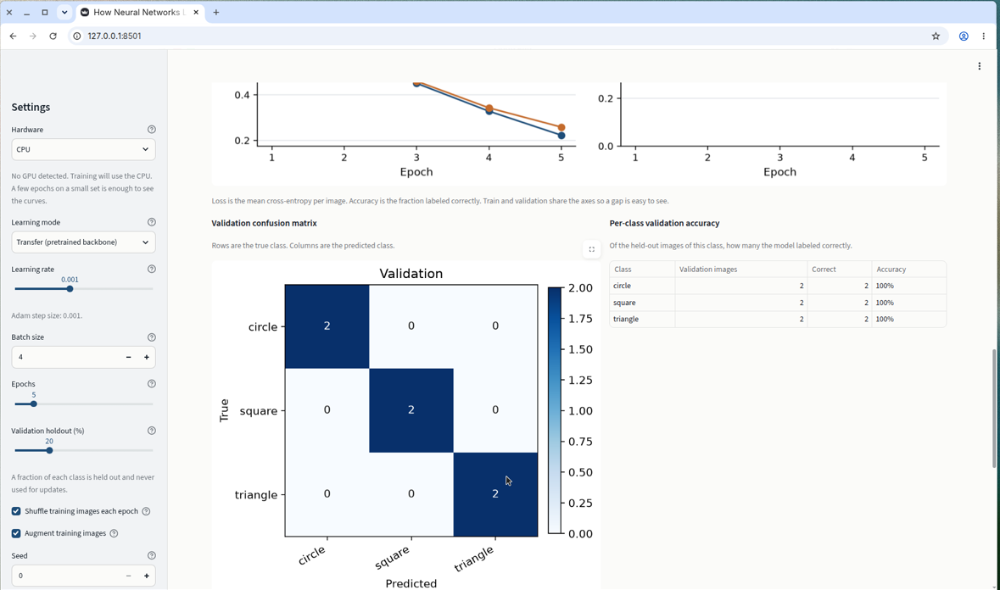
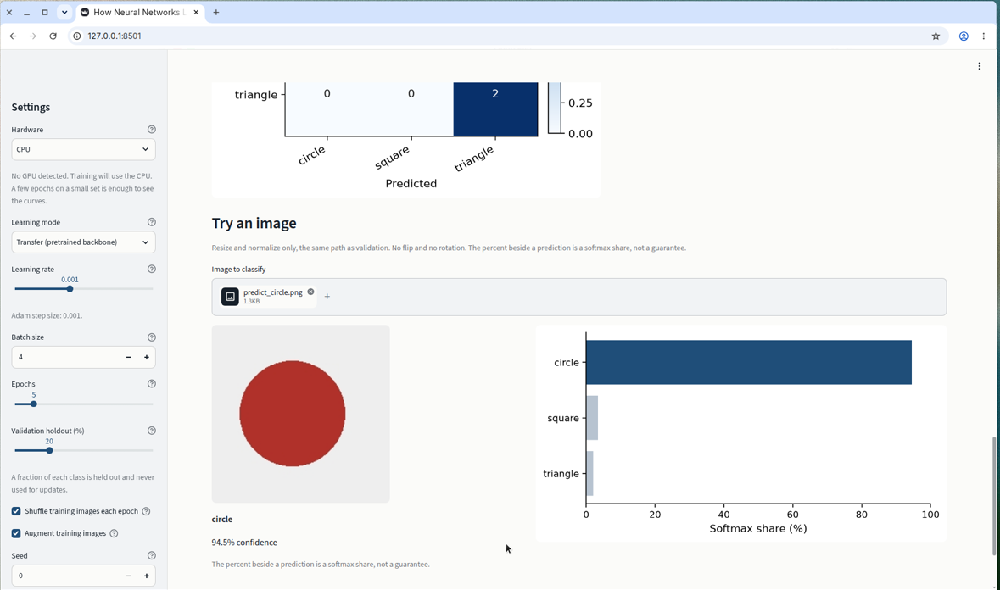

# How Neural Networks Learn: An Image Classifier Lab

[](https://github.com/jmamodeo/classifier-teaching-tool/actions/workflows/ci.yml)

A small Streamlit lab for watching an image classifier learn. Give it a few labeled images, or use the built-in circles, squares, and triangles, then train a ResNet-18 and read the charts.

Two modes share the images, the loss, and the learning rate. **Transfer** starts from ImageNet weights and trains a new final layer while the backbone stays frozen. **Novel** starts from random weights and trains every layer. The parameter cards, the curves, and the short explanations are there so that difference is visible.



## What a run looks like

Built-in drawings, eight per class. The cards count trainable parameters before any training starts. For three classes that is 1,539 in transfer mode and all 11,178,051 in novel mode.



Each training image is flipped and rotated again every time it is loaded, so a new epoch is a new draw. The preview shows four draws of one training image and the matching validation image, which is only resized.



Train and validation share both axes. On this five-epoch transfer run the mean loss fell on both sets, and training accuracy caught up with the holdout.



Rows of the confusion matrix are the true class. Per-class accuracy is the fraction of that class's held-out images labeled correctly.



A new image takes the validation path: resize and normalize, with no flip and no rotation. The percent is the softmax share.



The screenshots are one real run: transfer mode, CPU, Adam at learning rate 0.001, batch size 4, 5 epochs, 20% holdout, seed 0, shuffle and augmentation on.

## Quickstart

Python 3.11 or newer.

```bash
python3 -m venv .venv
source .venv/bin/activate
pip install torch==2.15.0 torchvision==0.29.2 --index-url https://download.pytorch.org/whl/cpu
pip install -r requirements.txt
python3 -m streamlit run main.py
```

Install the CPU wheels first on a machine without an NVIDIA GPU. The second command keeps them, because they already satisfy the pins in `requirements.txt`. On a machine with a GPU, `pip install -r requirements.txt` takes the default PyTorch wheel. The hardware menu lists CUDA when PyTorch reports it, and Apple silicon (MPS) when that backend is available.

The first transfer run downloads the ImageNet ResNet-18 weights, about 45 MB, from `download.pytorch.org`. Novel mode trains from random initialization and does not download weights.

## How a run works

1. Each class needs a label and at least two images, so one image can be held out and one can train. You can keep two to eight classes. The holdout is stratified: the same fraction of every class, at least one image each way. The seed chooses which images are held out.
2. Images are resized to 224×224. A training image may then be flipped left-right (probability 0.5) and rotated by up to 15°. That draw happens when the image is loaded for a batch, so each epoch sees new tensors. Validation images are resized only. Both modes use ImageNet mean and standard deviation, so the comparison is about the weights.
3. Transfer mode loads `ResNet18_Weights.IMAGENET1K_V1`, replaces the 1000-way layer with one for your classes, freezes the backbone, and leaves its BatchNorm layers in evaluation mode. The ImageNet running statistics stay fixed while the new layer trains. Novel mode builds the same ResNet-18 with `weights=None` and trains every parameter. The new final layer starts random in both modes.
4. Adam steps on the trainable parameters. The plotted loss is the mean cross-entropy per image: the sum of the per-image losses divided by the number of images scored.
5. After each novel-mode epoch, BatchNorm's stored averages are recomputed from the training images. On a handful of images the default momentum would leave those averages near their initialization, and the validation loss would describe that mismatch. Transfer mode leaves the ImageNet statistics where they are.
6. One figure shows training and validation loss, and training and validation accuracy. Under it, a confusion matrix and per-class accuracy on the holdout. A short note says whether the two losses moved together.
7. Prediction resizes and normalizes one image the same way as validation. The percent beside the label is that image's softmax share across your classes.

The seed sets initialization, the holdout, the shuffle order, and the augmentation sequence. The same seed on a CPU repeats the run. GPU kernels can still differ by a small amount.

Batch size starts at 2. ResNet-18's BatchNorm layers need more than one image in a batch. If the last training batch would be a single image, that image waits for another epoch rather than producing a NaN loss.

## Concepts

The panels in the app are the teaching copy. Each one is a short explanation of a control, and the numbers in the copy come from the same constants the training loop uses.

| Topic | What the app is showing |
| --- | --- |
| Transfer and novel | Where the weights start, and which of them receive gradients. |
| Learning rate | The size of the Adam step. The slider offers a few sizes, from 0.0001 to 0.03. |
| Batch size | How many images are scored before each update. |
| Epochs | One pass over the training images. |
| Validation split | Images the optimizer never uses, scored after every epoch. |
| Overfitting | Training loss falling while validation loss rises. The two curves share an axis so the gap is easy to see. |
| Augmentation | A fresh flip and a small rotation each time a training image is loaded. |
| Confidence | The softmax share. Read it next to the bar chart. |
| Seed | Makes the split, the shuffle, the augmentation, and the initial weights repeatable. |
| Shuffle | A new order of training images each epoch. |

## Layout

```
main.py                  Streamlit entry point
imagepro/data.py         loading, the holdout, augmentation
imagepro/model.py        ResNet-18 and the parameter counts
imagepro/training.py     the loop, metrics, prediction
imagepro/insights.py     a few sentences about the finished curves
imagepro/plots.py        loss, accuracy, confusion, class shares
imagepro/examples.py     the built-in shapes
imagepro/explanations.py the panels
imagepro/ui.py           the page
```

## Development

```bash
pip install torch torchvision --index-url https://download.pytorch.org/whl/cpu
pip install -e ".[dev]"
ruff check .
ruff format --check .
pytest
```

Tests build every model with `weights=None` and block the weight download, so they stay offline and on CPU. GitHub Actions runs Ruff and pytest on Python 3.11, 3.12, and 3.13.

## Boundaries

- A few images are enough to move the curves. The holdout is then only a handful of images, so validation accuracy jumps around. Read the shape of the curves, and treat a perfect confusion matrix on two images per class as a demonstration.
- The percent beside a prediction is the softmax share across the classes you trained.
- Augmentation is a horizontal flip and a rotation of at most 15°.
- Transfer mode trains the new final layer. The ImageNet backbone, including its BatchNorm statistics, stays fixed. That is the contrast the page is built to show.
- The optimizer is Adam for a fixed number of epochs.
- The example drawings differ in color and in outline, so a short run has an easy signal. They are a teaching set.

## License

MIT. Copyright (c) 2026 John Amodeo. See [LICENSE](LICENSE) and [CHANGELOG](CHANGELOG.md).
